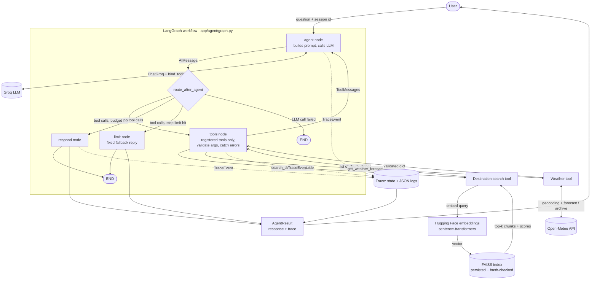

# Architecture

## Flow of one request

1. `TripMateAgent.ask` validates the input, creates a `request_id`, and invokes the compiled graph with
   `thread_id = session_id` (LangGraph `MemorySaver` keeps history per session only).
2. **agent** prepends the system prompt (with today's date) to the trimmed history and calls Groq through
   `ChatGroq` with both tools bound. The model decides: call tools, or answer / ask / decline directly.
3. **route_after_agent** sends tool calls to **tools**, plain replies to **respond**, and stops with **limit**
   when `MAX_GRAPH_STEPS` model calls have been used.
4. **tools** runs each requested call: unknown names are rejected, arguments are validated with the Pydantic
   schema, exceptions are caught. Every outcome becomes a `ToolMessage` and a trace event, then control returns to **agent**.
5. **respond** stores the final text. `AgentResult` carries the response and the trace; every trace event was
   also logged as one JSON line on the `tripmate.trace` logger.

## Retrieval

`scripts/ingest_data.py` -> `rag/ingestion.py` (one Document per section) -> `rag/chunking.py` (splitter + "City, Country - Section" prefix)
-> `rag/embeddings.py` -> FAISS (`normalize_L2`, so L2 distance maps to cosine similarity) -> saved with a `manifest.json`
holding SHA-256 hashes, the embedding id and the destination list. At startup the index is loaded only if the hashes and
embedding id match. If the query names an indexed destination, search is restricted to it with a metadata filter.

